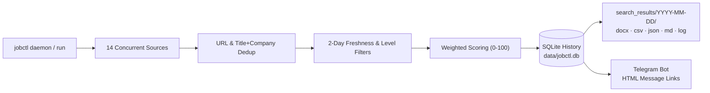

<div align="center">


# jobctl

**Control-plane CLI & Docker Daemon for your engineering job search. Aggregate, filter, score, and receive daily Telegram alerts for fresh remote roles across 14 ATS & job APIs.**


-0F172A.svg)


[Features](#why-jobctl) · [Portals](#supported-portals-14-sources) · [Telegram & Docker Daemon](#telegram--daily-docker-daemon-setup) · [Quick Start](#local-quick-start) · [Configuration](#configuration-jobctltoml) · [Architecture](#project-architecture)

</div>

---

## Why `jobctl`?

Job boards are flooded with stale 30-day-old ghost listings, senior/staff roles masquerading under generic searches, and naive keyword filters that match `git` inside *"digital"* or label *"international team"* as an internship.

`jobctl` treats job hunting like an engineering pipeline:

1. **Strict 2-Day Freshness (`max_posting_age_days = 2`):** Queries portals with 48-hour filters (`f_TPR=r172800` on LinkedIn, `max_days_old=2` on Adzuna) and drops any listing older than the previous two calendar dates.
2. **14 Concurrent Public APIs:** Fetches LinkedIn, Greenhouse, Ashby, Lever, Wellfound, Remotive, RemoteOK, WeWorkRemotely, Hacker News ("Who's Hiring"), SmartRecruiters, Recruitee, Workable, BDJobs, and Adzuna in parallel using a shared HTTP session with retries on `429` / `5xx`.
3. **Word-Boundary + Alias Skill Engine:** Matches whole terms with built-in synonym expansion (`postgres` / `psql` → `postgresql`, `k8s` / `helm` → `kubernetes`, `node` → `node.js`, `odoo` / `sap` → `erp`) while preventing substring false positives.
4. **Level-Aware Guardrails:** Configured out-of-the-box for **Mid-Level (2–5 years)**—accepting roles requiring up to 5 years while automatically excluding Senior, Staff, Principal, Lead, Director, VP, and Intern roles.
5. **SQLite Deduplication Across Runs:** Persists every match in `data/jobctl.db` so daily runs surface `[NEW]` opportunities without repeating previously seen listings.
6. **Scheduled Docker Daemon + Telegram Alerts:** Run `docker compose up -d` once—`jobctl daemon` wakes up every day at `11:00 AM` (configurable day, time & timezone via `.env`), saves dated reports to `search_results/<YYYY-MM-DD>/`, and sends formatted clickable job links to Telegram.



---

## Supported Portals (14 Sources)

| # | Source | Public API / Access Method | Auth Required? | Focus Area |
| :-: | :--- | :--- | :---: | :--- |
| 1 | **LinkedIn** | Guest Search (`f_WT=2`, `f_E=2,3,4`, `f_TPR=r172800`) | No | Global remote Software, Backend, DevOps & PostgreSQL roles posted in last 48h |
| 2 | **Greenhouse** | Official Public REST API (`boards-api.greenhouse.io`) | No | Cloud, DevOps & Data leaders (GitLab, Cloudflare, Datadog, HashiCorp, Cockroach Labs, Grafana Labs, Timescale, Vercel) |
| 3 | **Ashby** | Official Public REST API (`api.ashbyhq.com`) | No | Modern infra & Postgres platforms (Supabase, Neon, Railway, Render, Linear, Sentry, PostHog, OpenAI) |
| 4 | **Lever** | Official Public REST API (`api.lever.co`) | No | Scaling engineering orgs (Spotify, Postman, Atlassian, Auth0, Palantir, Zapier) |
| 5 | **Wellfound** | Next.js Apollo Graph Feed + JSON-LD | No | Remote-first Seed to Series C startups |
| 6 | **Remotive** | Official Public JSON API (`remotive.com/api/remote-jobs`) | No | Dedicated remote Software Dev & DevOps roles |
| 7 | **RemoteOK** | Official Public JSON Feed (`remoteok.com/api`) | No | Worldwide remote engineering listings |
| 8 | **WeWorkRemotely** | Official Public RSS Feeds (`weworkremotely.com/*.rss`) | No | Remote Back-End, Full-Stack & DevOps/Sysadmin boards |
| 9 | **Hacker News** | Official Algolia JSON API (`hn.algolia.com/api/v1`) | No | Latest monthly *"Ask HN: Who is hiring?"* comments posted in last 2 days |
| 10 | **SmartRecruiters** | Official Public Posting API (`api.smartrecruiters.com`) | No | Global tech & cloud companies (Aiven, Block, Square, Visa, Equinix, Wolt) |
| 11 | **Recruitee** | Official Public Careers API (`*.recruitee.com/api/offers`) | No | Remote-friendly SaaS & product orgs (Baserow, Hotjar, Mollie, Framer) |
| 12 | **Workable** | Public Widget JSON API (`apply.workable.com/api/v1/widget`) | No | Open-source & database companies (Percona, Canonical, Netdata, Mattermost) |
| 13 | **BDJobs** | Public Web Search JSON Endpoint (`api.bdjobs.com`) | No | Bangladesh software, DevOps & ERP listings |
| 14 | **Adzuna** | REST API (optional, via `.env`) | API Key | Global job aggregator (`max_days_old=2`) |

---

## Telegram & Daily Docker Daemon Setup

All Telegram credentials and schedule settings are loaded **strictly via environment variables** (`.env`, which is git-ignored), so API tokens and chat IDs never appear in source code or commits. Notifications are **message-only** (`sendMessage` HTML digests with clickable job links—no file uploads).

### Step 1: Create Your Telegram Bot & Get `TELEGRAM_BOT_TOKEN`
1. Open Telegram (mobile or desktop) and search for **[@BotFather](https://t.me/BotFather)** (verified blue checkmark).
2. Send `/newbot`.
3. Enter a display name (for example: `jobctl Daily Alerts`).
4. Enter a username ending in `bot` (for example: `arif_jobctl_bot`).
5. Copy the HTTP API token BotFather returns — this is your **`TELEGRAM_BOT_TOKEN`**.

### Step 2: Activate Your Bot & Get `TELEGRAM_CHAT_ID`
1. Open `t.me/<your_bot_username>` from BotFather's message, press **Start**, and send `hello`. *(Telegram bots cannot initiate messages until you press Start first.)*
2. Retrieve your numeric **`TELEGRAM_CHAT_ID`** via either method:
   - **Option A (`@userinfobot`):** Message **[@userinfobot](https://t.me/userinfobot)** and press **Start** — it immediately replies with your `Id`.
   - **Option B (`getUpdates` API):** Run:
     ```bash
     curl -s "https://api.telegram.org/bot<YOUR_BOT_TOKEN>/getUpdates"
     ```
     and copy the numeric ID from `"chat":{"id":...}`.

### Step 3: Configure `.env` (Git-Ignored)
Copy [`.env.example`](.env.example) to `.env` and fill in your values:
```bash
cp .env.example .env
```

```dotenv
# --- Timezone & Daily/Weekday Schedule (Changeable anytime) ---
TZ=Asia/Dhaka
JOBCTL_SCHEDULE_TIME=11:00
# Options: "daily" (or "*"), "weekdays", "weekends", or comma-separated days: "sun,mon,tue,wed,thu"
JOBCTL_SCHEDULE_DAYS=daily
# Set to true if you also want an immediate run when the container starts
JOBCTL_RUN_ON_STARTUP=false

# --- Telegram Bot Credentials (Formatted messages & links only, no files sent) ---
TELEGRAM_ENABLED=true
TELEGRAM_BOT_TOKEN=your_bot_token_here
TELEGRAM_CHAT_ID=your_numeric_chat_id_here
TELEGRAM_NOTIFY_ON_EMPTY=true
```

### Step 4: Verify Your Telegram Connection
Send a diagnostic test message before starting the daemon:
```bash
jobctl notify-test
# Or via Docker:
docker compose run --rm jobctl notify-test
```

### Step 5: Start the Background Docker Container (`-d`)
- **Using Docker Compose (Recommended):**
  ```bash
  docker compose up -d --build
  ```
- **Or using `docker run -d`:**
  ```bash
  docker build -t jobctl:latest .
  docker run -d \
    --name jobctl-daemon \
    --restart unless-stopped \
    --env-file .env \
    -v "$(pwd)/search_results:/app/search_results" \
    -v "$(pwd)/data:/app/data" \
    jobctl:latest daemon
  ```
- **Inspect live daemon schedule & logs:**
  ```bash
  docker logs -f jobctl-daemon
  ```
- **Change schedule day or time later (without rebuilding):**
  Edit `JOBCTL_SCHEDULE_TIME` (e.g., `09:30`) or `JOBCTL_SCHEDULE_DAYS` (e.g., `sun,mon,tue,wed,thu`) in `.env` and run `docker compose up -d`.

#### Telegram Alert Format Preview (Messages + Links Only)
```text
🚀 jobctl Daily Job Report — 2026-11-22 11:00
👤 Profile: Software Engineer (Mid-Level (2-5 yrs) · Remote)
⏱ Window: Previous 2 days (2026-11-20 to 2026-11-22)
📂 Saved to: search_results/2026-11-22
✅ New Matches: 2

1. [88/100] Backend Engineer — Supabase
   📅 2026-11-22 · 🌍 remote (full-time) · Ashby (supabase)

2. [82/100] DevOps Engineer — GitLab
   📅 2026-11-21 · 🌍 remote (full-time) · Greenhouse (gitlab)
```

---

## Local Quick Start

```bash
python3 -m venv .venv
source .venv/bin/activate
pip install -e .

# Optional: initialize your personal jobctl.toml from the template
jobctl init

# Run a one-shot search (automatically sends Telegram links if TELEGRAM_BOT_TOKEN is set in .env)
jobctl run
```

### CLI Commands

| Command | Description |
| :--- | :--- |
| `jobctl run` | Fetch all enabled portals (last 2 days), score, export to `search_results/<YYYY-MM-DD>/`, and notify Telegram if configured |
| `jobctl run --dry-run -v` | Test fetch and scoring in terminal without writing files, SQLite history, or Telegram alerts |
| `jobctl run --sources remotive,ashby` | Query only the specified comma-separated sources |
| `jobctl run --notify` / `--no-notify` | Force-enable or suppress Telegram notification for a single run |
| `jobctl run --all` | Include previously seen jobs in exported reports |
| `jobctl daemon` | Run continuous background scheduler (`--time`, `--schedule-days`, `--tz`, `--run-on-startup`) |
| `jobctl notify-test` | Send a test message to verify `TELEGRAM_BOT_TOKEN` and `TELEGRAM_CHAT_ID` |
| `jobctl sources` | List all 14 registered sources, enabled status, and per-source limits |
| `jobctl history --limit 25` | Inspect recently discovered jobs recorded in SQLite (`--urls` shows direct links, `--path` shows DB path) |
| `jobctl history --clear` | Delete all tracked jobs from SQLite history (`--older-than N` prunes entries older than N days) |
| `jobctl init` | Create `jobctl.toml` from [`jobctl.example.toml`](jobctl.example.toml) |

### Makefile Shortcuts

```bash
make install       # Create .venv and install package with dev dependencies
make test          # Run the offline unit test suite
make lint          # Run ruff checks on src/ and tests/
make run           # Execute a one-shot jobctl run
make daemon        # Run the scheduler locally in foreground
make notify-test   # Send a Telegram diagnostic message
make history-clear # Clear all tracked jobs from SQLite (data/jobctl.db)
make reset-all     # Delete data/jobctl.db and all search_results/ folders
make docker-up     # Build and start jobctl-daemon in background (docker compose up -d --build)
make docker-logs   # Tail live logs from jobctl-daemon
make docker-down   # Stop and remove the Docker Compose container
```

---

## Configuration (`jobctl.toml`)

All search settings live in `jobctl.toml` (generated from [`jobctl.example.toml`](jobctl.example.toml), git-ignored so personal overrides stay local):

```toml
[profile]
role_title = "Software Engineer"
level = "mid"                      # intern | entry | junior | mid | senior
work_modes = ["remote"]
job_types = ["full-time", "contract"]
location = "Worldwide"

skills = [
    "typescript", "javascript", "node.js", "nestjs", "express",
    "react", "next.js", "postgresql", "sql", "redis",
    "docker", "kubernetes", "ci/cd", "github actions", "aws",
    "linux", "terraform", "nginx", "microservices", "rest api", "erp",
]

[filters]
max_posting_age_days = 2           # Strictly only jobs from the previous 2 dates
require_posted_date = true         # Drop listings without a verifiable timestamp

[scoring]
min_score = 60
min_skills_pct = 50
min_title_pct = 50
skill_match_target = 5
weights = { skills = 0.55, title = 0.35, job_type = 0.10 }

[output]
results_dir = "search_results"
formats = ["docx", "csv", "json", "md"]
only_new = true
history_db = "data/jobctl.db"
```

### Built-in Level Presets

| Level Key | Experience Range | Max Years Allowed | LinkedIn `f_E` | Title Exclusions |
| :--- | :--- | :---: | :---: | :--- |
| `intern` | 0 yrs | `0` | `1` | Senior, Sr, Staff, Principal, Lead, Manager, Director, Head, VP, Chief, Architect, Junior, Mid, II, III |
| `entry` | 0–1 yr | `1` | `1,2` | Senior, Sr, Staff, Principal, Lead, Manager, Director, Head, VP, Chief, Architect, II, III |
| `junior` | 0–2 yrs | `2` | `1,2` | Senior, Sr, Staff, Principal, Lead, Manager, Director, Head, VP, Chief, Architect, III |
| **`mid`** | **2–5 yrs** | **`5`** | **`2,3,4`** | **Senior, Sr, Staff, Principal, Lead, Manager, Director, Head, VP, Chief, Architect, Intern, Internship** |
| `senior` | 5–10 yrs | `10` | `4` | Principal, Director, VP, Head, Chief, Intern, Internship |

---

## Dated Output Folder Structure (`search_results/`)

Every execution creates a dated subfolder (`YYYY-MM-DD`) inside `search_results/` and timestamps each run (`HHMMSS`) so multiple runs on the same day never overwrite each other:

```text
search_results/
└── 2026-11-22/
    ├── jobctl_110000.docx     # Branded Word report with clickable Apply hyperlinks
    ├── jobctl_110000.csv      # Spreadsheet-ready tabular export
    ├── jobctl_110000.json     # Structured JSON payload for automation
    ├── jobctl_110000.md       # Markdown digest table
    └── run_110000.log         # Full telemetry log, rejection breakdown & near-misses
```

---

## Project Architecture

```text
jobctl/
├── pyproject.toml                 # Package metadata, dependencies & console entry point
├── jobctl.example.toml            # Documented TOML configuration template
├── .env.example                   # Schedule & Telegram environment variable template
├── Dockerfile                     # Non-root Python 3.12 container image (with tzdata)
├── docker-compose.yml             # Background daemon service (`docker compose up -d`)
├── Makefile                       # Local & Docker workflow shortcuts
├── CHANGELOG.md                   # Release changelog
├── assets/
│   └── logo.png                   # jobctl brand icon
├── search_results/                # Auto-created dated output folders (<YYYY-MM-DD>/)
├── data/                          # SQLite job history database (jobctl.db)
├── src/jobctl/
│   ├── __init__.py                # Package version metadata
│   ├── __main__.py                # Enables `python -m jobctl`
│   ├── cli.py                     # CLI argument parser & subcommands
│   ├── config.py                  # Typed dataclasses, TOML loader & level presets
│   ├── models.py                  # Job, ScoredJob, ScoreBreakdown & SourceStat models
│   ├── pipeline.py                # Concurrent source execution & export orchestration
│   ├── scheduler.py               # Timezone-aware daily/weekday daemon scheduler
│   ├── log.py                     # Console & per-run file logging
│   ├── matching/
│   │   ├── text.py                # Word-boundary skill regexes, aliases & years parser
│   │   ├── filters.py             # Strict 2-day freshness & level-aware hard filters
│   │   └── scoring.py             # Weighted 0–100 scoring & URL deduplication
│   ├── notifiers/
│   │   └── telegram.py            # Message-only Telegram Bot HTML digest sender
│   ├── sources/
│   │   ├── base.py                # JobSource ABC, @register_source & retry HTTP session
│   │   ├── common.py              # Shared HTML stripping, work-mode & job-type inference
│   │   ├── linkedin.py            # LinkedIn 48h remote guest search adapter
│   │   ├── greenhouse.py          # Greenhouse ATS adapter
│   │   ├── lever.py               # Lever ATS adapter
│   │   ├── ashby.py               # Ashby ATS adapter
│   │   ├── wellfound.py           # Wellfound startup jobs adapter
│   │   ├── remotive.py            # Remotive JSON API adapter
│   │   ├── remoteok.py            # RemoteOK JSON feed adapter
│   │   ├── weworkremotely.py      # WeWorkRemotely RSS feed adapter
│   │   ├── hackernews.py          # Hacker News Algolia "Who's Hiring" adapter
│   │   ├── smartrecruiters.py     # SmartRecruiters Posting API adapter
│   │   ├── recruitee.py           # Recruitee Careers API adapter
│   │   ├── workable.py            # Workable Widget JSON API adapter
│   │   ├── bdjobs.py              # BDJobs Search JSON API adapter
│   │   └── adzuna.py              # Optional Adzuna aggregator adapter
│   ├── storage/
│   │   └── history.py             # SQLite seen/new job tracker
│   └── exporters/
│       ├── paths.py               # search_results/<YYYY-MM-DD>/ path builder
│       ├── docx.py                # Branded Word exporter with clickable links
│       └── tabular.py             # CSV, JSON & Markdown exporters
└── tests/                         # Offline unit test suite (9 test modules)
```

---

## License

MIT — see [LICENSE](LICENSE).
